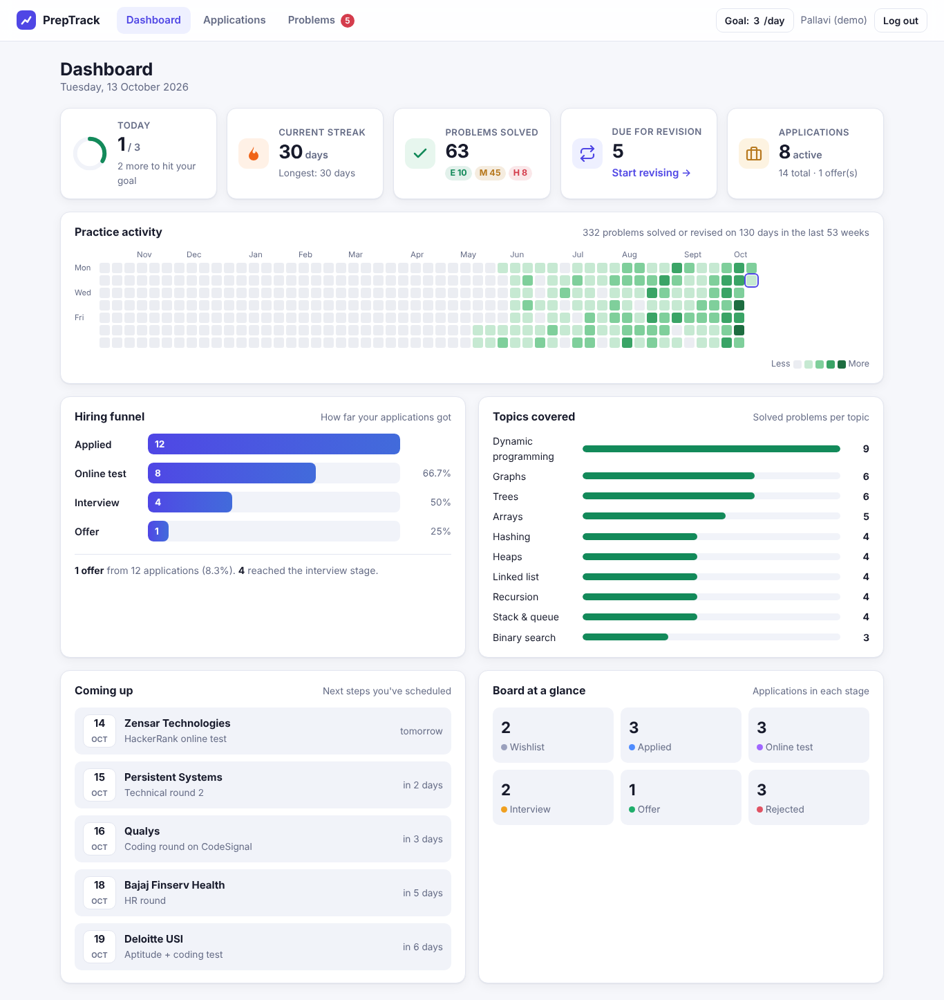
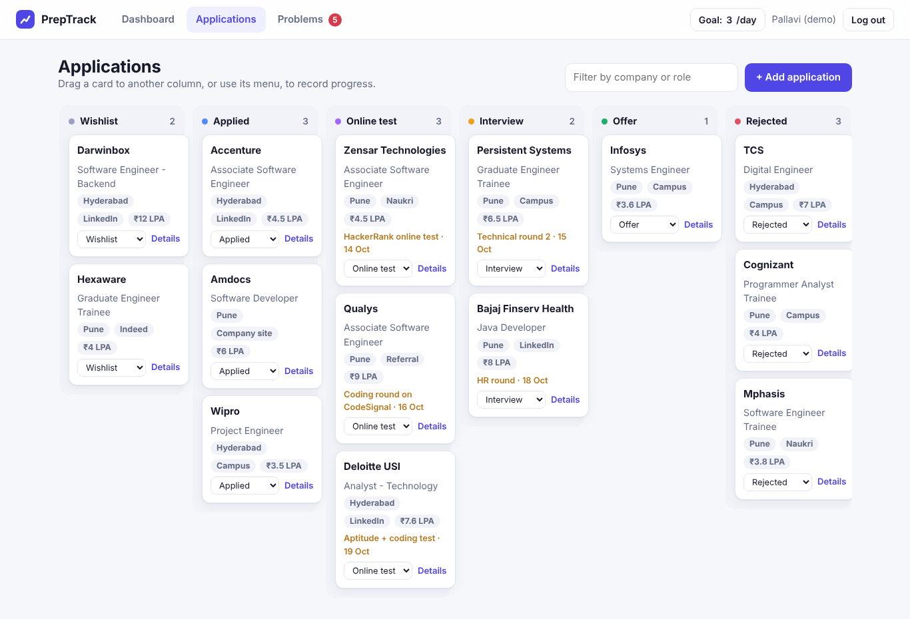
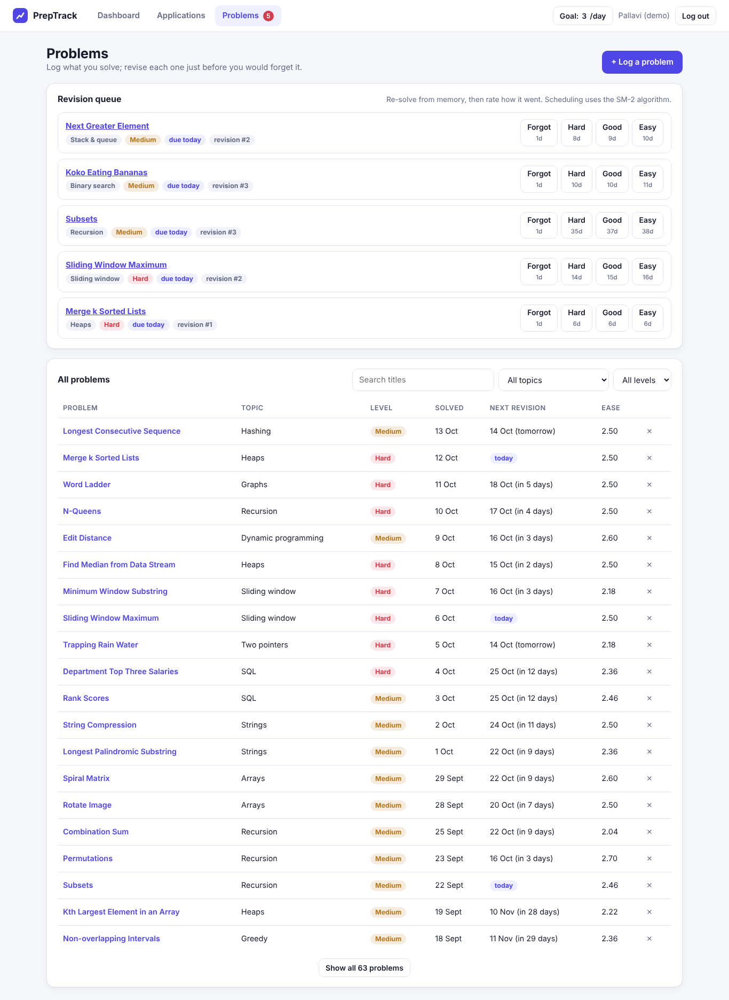
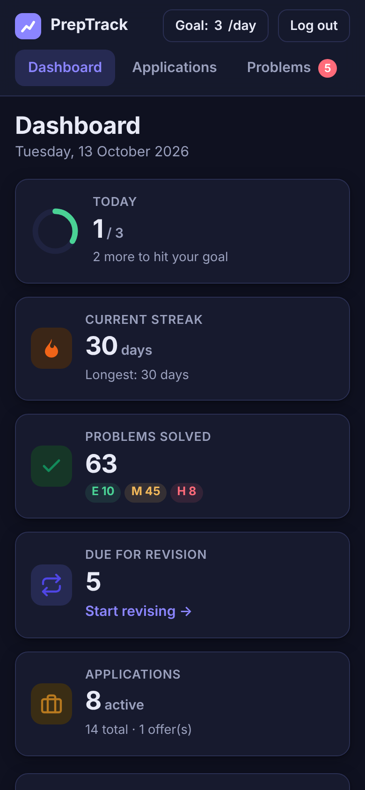
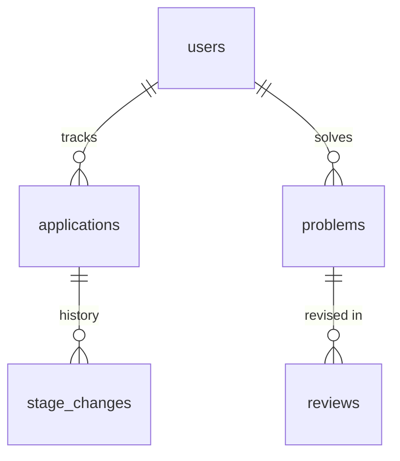

# Placement Prep Tracker

A full-stack app for placement season. It keeps three things in one place:

1. **Job applications** on a Kanban board: Wishlist → Applied → Online test → Interview → Offer / Rejected. Every move is recorded.
2. **Solved DSA problems** with a **spaced-repetition revision queue**. It uses the SM-2 algorithm, so you revise each problem just before you would forget it.
3. A **dashboard**: a daily goal, practice streaks, a GitHub-style activity heatmap, the hiring funnel with conversion rates, topic coverage and upcoming interview dates.

Built with **Java 21, Spring Boot 3, Spring Security (JWT), Spring Data JPA, Flyway and MySQL**. The front end is responsive vanilla JavaScript and needs no build step. The project has **68 JUnit tests** and **13 Playwright end-to-end tests**, and a GitHub Actions CI pipeline runs all of them against H2 and MySQL.



| Applications board | Revision queue | Mobile (dark mode) |
|---|---|---|
|  |  |  |

---

## Features

**Applications board**
- Move cards between stages by drag and drop, or with each card's stage menu (better for keyboards and phones).
- Each card stores company, role, location, source (LinkedIn, Naukri, Indeed, campus, referral, ...), package in LPA, job link, next step with its date, and notes.
- The full stage history of each application is stored in `stage_changes` and shown in its details.

**Problems and spaced revision**
- Log problems from LeetCode, GFG, HackerRank, CodeChef or Codeforces, with topic and difficulty.
- The revision queue lists everything due today or overdue. You re-solve the problem, then rate your recall as *Forgot / Hard / Good / Easy*. Each button previews how many days until the next revision.
- Scheduling is SuperMemo-2 ([`Sm2.java`](src/main/java/com/placementprep/core/Sm2.java)):
  - The ease factor changes by `0.1 − (5−q)(0.08 + (5−q)·0.02)` and has a floor of 1.3.
  - Intervals go 1 day → 6 days → previous interval × ease, capped at 365 days.
  - A failed recall resets the problem to 1 day.
  - Ease is stored as an integer in hundredths, so no floating-point drift builds up over many reviews.

**Dashboard**
- Today's progress ring against your daily goal (you can change the goal).
- Current and longest streak. A streak still counts as current until today ends.
- An activity heatmap with Monday-aligned weeks. Each cell is shaded on five levels relative to your busiest day, and the grid widens to fill the screen.
- Hiring funnel: an application counts toward every stage it reached, even if it was rejected later. So a rejection after the interview still counts for Applied, Online test and Interview.
- Topic and difficulty breakdowns, upcoming next steps, and a count of applications in each stage.

**Engineering**
- **Stateless JWT authentication** (HS256, jjwt). Passwords are hashed with BCrypt.
- Every query is scoped to the signed-in user. Another user's record returns 404, so record ids can't be probed.
- **"Today" uses the user's time zone** (`app.zone`, default `Asia/Kolkata`) through an injected `Clock`. A problem solved at 11 pm IST counts for that day, and tests can pin the date.
- Dashboard numbers come from **JPQL group-by projections**, not by loading every row.
- **Flyway** owns the schema: foreign keys with cascades, CHECK constraints and indexes for the due-queue and heatmap queries.
- One consistent JSON error format: `{status, error, message, fields, timestamp}`. Validation errors name the field that failed.
- Security headers: a strict Content-Security-Policy and no inline scripts. All user text is inserted with `textContent`, never `innerHTML`.
- OpenAPI/Swagger UI at `/swagger-ui.html`, and Actuator health probes.

## Architecture

```
src/main/java/com/placementprep
├── core/        Pure algorithms, no Spring: Sm2, Streaks, Heatmap, Funnel, Stage
├── domain/      JPA entities: User, Application, StageChange, Problem, Review
├── repository/  Spring Data repositories + JPQL constructor projections
├── service/     Business rules: AuthService, ApplicationService, ProblemService, DashboardService
├── security/    JwtService, JwtAuthFilter, SecurityConfig
├── web/         REST controllers, DTOs (records), GlobalExceptionHandler
└── config/      Clock (IST), OpenAPI, DemoData seeder
src/main/resources
├── db/migration/V1__schema.sql
└── static/      index.html, css/app.css, js/app.js, api.js, sm2.js
```



## REST API

All endpoints except `/api/auth/*` need `Authorization: Bearer <token>`.

| Method | Path | Purpose |
|---|---|---|
| POST | `/api/auth/register` | Create an account → `{token, user}` |
| POST | `/api/auth/login` | Sign in → `{token, user}` |
| GET | `/api/me` | Current user |
| PUT | `/api/me/goal` | Set the daily goal (1–50) |
| GET | `/api/applications?stage=` | List applications, optionally by stage |
| POST | `/api/applications` | Add an application (stage defaults to APPLIED) |
| PUT | `/api/applications/{id}` | Edit an application |
| PATCH | `/api/applications/{id}/stage` | Move to another stage (records history; idempotent) |
| GET | `/api/applications/{id}/history` | Stage timeline |
| DELETE | `/api/applications/{id}` | Delete an application and its history |
| GET | `/api/problems?topic=&difficulty=&q=` | Search solved problems |
| POST | `/api/problems` | Log a solved problem (first revision the next day) |
| GET | `/api/problems/due` | Revision queue |
| POST | `/api/problems/{id}/review` | Grade a revision `{quality: 0-5}` → next schedule |
| DELETE | `/api/problems/{id}` | Delete a problem and its reviews |
| GET | `/api/dashboard?weeks=` | All dashboard figures in one call |

## Running it

**Option 1: Java only** (in-memory H2 database, demo data included)

```bash
mvn spring-boot:run
# open http://localhost:8080 and choose "Try the demo account" (demo@prep.in / demo1234)
```

**Option 2: Docker with MySQL 8**

```bash
cp .env.example .env        # set your own JWT_SECRET
docker compose up --build
```

| Setting | Default | Meaning |
|---|---|---|
| `JWT_SECRET` | dev value | HS256 signing key, at least 32 characters. **Always set this in production.** |
| `APP_ZONE` | `Asia/Kolkata` | Time zone that decides what "today" means |
| `DEMO_DATA` | `true` | Seed the demo account (about 5 months of history) |
| `SPRING_PROFILES_ACTIVE=mysql` + `DB_URL`, `DB_USER`, `DB_PASSWORD` | – | Use MySQL instead of H2 |

## Tests

```bash
mvn verify                        # 68 JUnit tests + JaCoCo report in target/site/jacoco
cd e2e && npm install && npx playwright install chromium
BASE_URL=http://localhost:8080 npx playwright test   # 13 browser tests (app must be running)
```

| Layer | What is covered |
|---|---|
| Core algorithms (27) | SM-2 grade by grade, ease floor and interval cap; streaks across gaps, month and year ends, future dates; heatmap alignment and shading; funnel counting and divide-by-zero |
| Services (28, Mockito) | Stage transitions and history, idempotent moves, apply dates, ownership 404s, SM-2 scheduling through the service, validation, dashboard aggregation |
| Security (4) | Token round trip, tampering, wrong secret, expiry |
| API integration (9, MockMvc + H2/MySQL) | Auth, validation errors, full board flow, data isolation between users, revision flow, demo seed |
| End to end (13, Playwright) | Sign-in, registration, drag and drop, stage menu, history, filters, revision grading, daily goal, mobile layout |

CI (`.github/workflows/ci.yml`) has four jobs:
- unit and integration tests on H2
- integration tests on a real MySQL 8 service
- Playwright against the built jar
- a Docker image build
